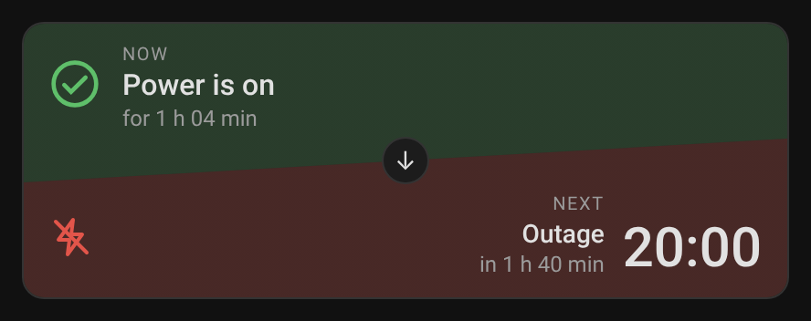
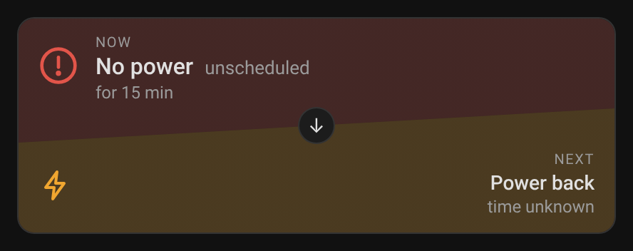
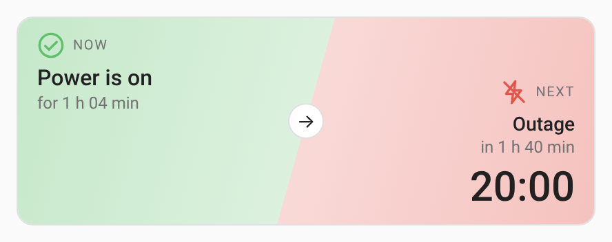
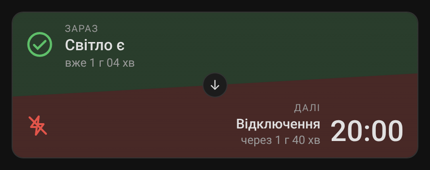
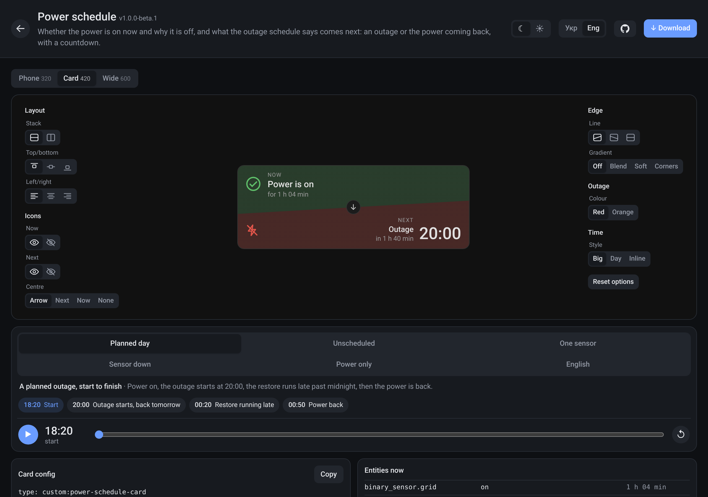

# widgets

Cards for [Home Assistant](https://www.home-assistant.io/) dashboards, shipped
together in one file, `widgets.js`. Every card has a live preview site where
you can play it through each state it can be in, change its options and copy
the config.

**[Open the previews →](https://dolifer.github.io/widgets/)**



## Cards

| Card | Type | What it shows | |
|---|---|---|---|
| [Power schedule](widgets/power-schedule-card/) | `custom:power-schedule-card` | Whether the power is on now (and why it is off), and what the outage schedule says comes next, with a countdown | [preview](https://dolifer.github.io/widgets/power-schedule-card/) |

Each card has its own README with every option: start from the table above.

### Power schedule

Answers two questions at a glance: **is the power on now**, and **what
comes next** (an outage or the power coming back, with the time and a
countdown). It reads a power sensor and either two timestamp sensors (next
outage, next restore) or one combined schedule sensor, which is how most
outage-schedule integrations expose them.

| | |
|---|---|
|  |  |
| Unscheduled outage: the top says why, the bottom says when it comes back | `layout: horizontal`, `gradient: soft`, light theme |
|  | Speaks English and Ukrainian, following your Home Assistant profile; every label, colour and icon can be changed |

```yaml
type: custom:power-schedule-card
entity: binary_sensor.grid_power        # on = power
next_outage: sensor.next_planned_outage # timestamp sensors
next_restore: sensor.next_connectivity
```

Full options: [widgets/power-schedule-card/README.md](widgets/power-schedule-card/README.md).

## Install

### HACS (recommended)

1. Open HACS → ⋮ (top right) → **Custom repositories**.
2. Repository `https://github.com/dolifer/widgets`, type **Dashboard**, then **Add**.
3. Find **Widgets** in HACS, open it and **Download**. HACS adds the
   dashboard resource for you.
4. Reload the browser. On the phone app: Settings → Companion app →
   Debugging → Reset frontend cache.

HACS offers each new release as an update. Pre-releases (`-beta`) show only
when you turn on "Show beta versions" for the repository in HACS.

### By hand

1. Download `widgets.js` from the
   [latest release](https://github.com/dolifer/widgets/releases) and save it as
   `/config/www/widgets.js` on your Home Assistant host.
2. **Settings → Dashboards → ⋮ → Resources → Add resource**: URL
   `/local/widgets.js?v=1`, type **JavaScript module**. For YAML-mode dashboards:

   ```yaml
   lovelace:
     resources:
       - url: /local/widgets.js?v=1
         type: module
   ```
3. Reload the browser.

When you replace the file with a newer one, bump `?v=1` to `?v=2`, or browsers
keep the old copy.

### Adding a card

Edit a dashboard → **Add card** → search for the card's name (for example
"Power schedule"), or add a **Manual** card and paste YAML from the card's
README or from its preview page (**Card config → Copy**).

## The preview site

[dolifer.github.io/widgets](https://dolifer.github.io/widgets/) is built from
this repo on every merge. For each card it shows:

- **States:** the situations the card handles, each with a timeline. Pick
  one, then press play or drag the clock to watch it change (an outage
  starting, a restore running late, the power coming back).
- **Options** beside the card: layout, icons, edges, colours, time style.
  Every pick lands in the config shown below the card, ready to copy.
- **Width** (phone, card, wide), **theme** (dark, light) and **language**.



`https://dolifer.github.io/widgets/widgets.js` is the build of main, for
trying a change before it is released.

## Versions

The bundle has one version, and each release on GitHub lists the version of
every card inside it. Versions follow [semver](https://semver.org/):
`1.0.0-beta.1` is a pre-release, `1.0.0` the first stable one.

## Development

No build step for the cards: each is one JavaScript file with no
dependencies, so it can be copied into `/config/www` as is. The tooling
(Node 22) only validates, tests and builds the preview site.

### Layout

```
widgets/<id>/
  <id>.js          the card: one file, no build step
  widget.yaml      name, version, and the states the preview plays
  README.md        install and options
  render-check.js  optional: layout rules the render test checks (see below)
  i18n.yaml        the preview page's text from widget.yaml, per language (see below)
schema/widget.schema.yaml   what widget.yaml may hold
tools/build.mjs             validate + generate dist/ (the Pages site)
tools/release.mjs           pack widgets.js, every card in one file, for a release
hacs.json                   tells HACS to install widgets.js
tools/preview/              the preview runtime: fake clock, <ha-card>, themes
tools/preview/i18n.mjs      the preview site's own text, per language
tests/                      node tests; render.mjs drives a real browser
```

### Commands

```sh
npm ci
npm run check            # validate every widget.yaml
npm test                 # node tests
npm run build            # dist/
npm run serve            # http://localhost:8080 after a build
npm run test:render      # every state in Chromium (needs Playwright; skips without)
npm run test:render -- --coverage   # also: how much of each card the renders ran, and the lines never run
```

### States in widget.yaml

A state is the entities a card sees, plus an optional timeline of changes as
the preview clock moves. Times are relative to the start: `now`,
`now+1h40m`, `now-2d`. A state that is a time token becomes an ISO time, as
a timestamp sensor holds; inside a longer string write `{now+2h}`.

```yaml
states:
  - id: on-outage-next
    title: Power on, outage at 20:00
    label: Planned day          # short name on the state toggle (≤16 chars, default: title)
    entities:
      binary_sensor.grid: { state: "on", changed: now-1h04m }
      sensor.next_outage: now+1h40m
    timeline:
      - at: now+1h40m
        note: Outage starts
        set:
          binary_sensor.grid: "off"
          sensor.next_restore: now+5h40m
```

`preview.clock: "18:20"` starts every run at the same wall time, so the
pages look the same each day. `preview.languages` lists the languages the
card speaks; the preview offers only those. The schema has the rest.

`preview.options` lists card options the preview offers as chips (layout,
align, gradient, …). A pick overrides that key in every state's config, goes
into the URL (`o.align=center`) and shows in the config panel:

```yaml
preview:
  options:
    - { key: align, label: Align, default: left, values: [left, center, right] }
    - { key: gradient, label: Gradient, default: false, values: [false, true] }
```

### Page language

The language picker in the header switches the card and the whole page. The
page's own text (buttons, clock, panels) is in `tools/preview/i18n.mjs`; text
that comes from widget.yaml (name, options, state titles, event notes) is in
the widget's `i18n.yaml`, keyed by the English:

```yaml
uk:
  Power schedule: Графік світла
  Planned day: Плановий день
```

`npm run check` fails when a language in `preview.languages` misses a text, or
a key matches no text any more. The theme picker sets the page's theme too.

### Layout checks

States are situations only: what the sensors say and how that changes. Looks
are not states; they are `preview.options`, picked with chips. The render
test puts every state through them anyway: each option value on its own,
every combination of `test.matrix`, and each config in `test.configs`
(passed to the page as `?cfg=<json>`):

```yaml
test:
  matrix: [layout, align, valign]
  configs:
    - { height: 130 }
```

`npm run test:render` opens every state, at the start and at each timeline
event, at phone width (320 px) and the widget's own width, in every declared
language. If `widgets/<id>/render-check.js` exists, it runs after each render:
a function of the card element that returns problems as strings (text
crossing a seam, text cut off, …). Any problem fails the run.

A state or timeline event may list `expect:` text the card must show at that
point, in the state's language; a leading `!` means it must not appear:

```yaml
    expect: [Немає світла, за графіком, "!Відключень не заплановано"]
```

### Releases

All cards ship as one file, `widgets.js`, like Mushroom: install once, get
every card. The bundle has one version (`version` in `package.json`); each
card keeps its own in its `widget.yaml` and `VERSION`, listed in the release
notes. Bump the bundle at the level of the biggest card change, merge, then
tag:

```sh
git tag v1.0.1 && git push origin v1.0.1
```

`release.yml` checks the tag against `package.json` and attaches
`widgets.js`. A pre-release version (`1.0.0-beta.1`) makes a draft
pre-release, to publish by hand after trying it.

Or run **Actions → Release → Run workflow** on main: it tags `v<version>`
from `package.json` and publishes the same way.

### CI

Every job runs on a GitHub-hosted runner (`ubuntu-latest`): the repo is
public, so they cost nothing, and a fork's pull request never reaches a
machine at home. Do not add a self-hosted one.

- `ci.yml`: pull requests: check, test, build, render every state with coverage.
- `pages.yml`: main: test, build, deploy to GitHub Pages
  (Settings → Pages → Source: GitHub Actions).
- `release.yml`: tags `v<semver>`, or run by hand on main: pack `widgets.js` and publish it.

## Licence

[MIT](LICENSE).
